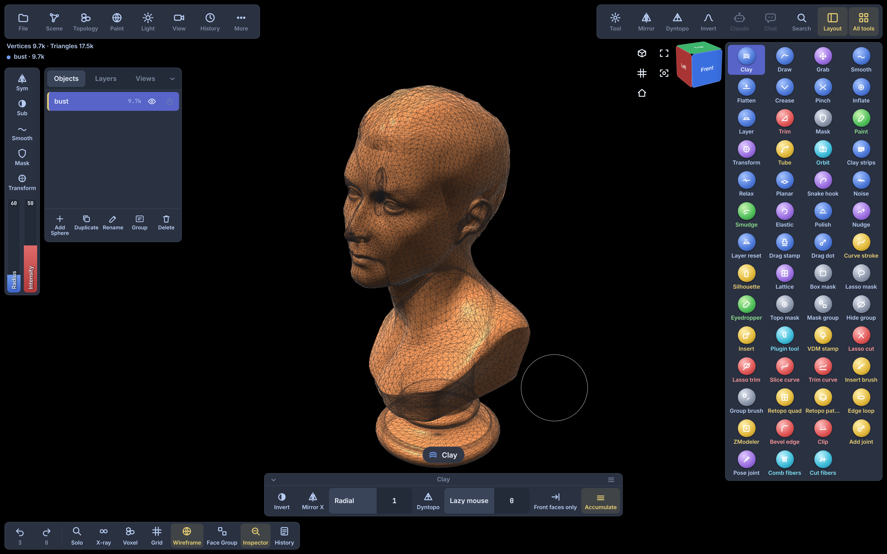

<p align="center">
  
</p>

<h1 align="center">FormSculpt</h1>

<p align="center">
  <b>3D sculpting; a Rust engine and a studio viewport for the Form family.</b><br>
  Brushes, quad remesh, UVs, painting and a path renderer,<br>
  on your own machine with no account. Agents sculpt over MCP.
</p>

<p align="center">
  
  
  
  
  
  
</p>

<p align="center">
  <a href="https://formsculpt.formai.studio/"><b>Download FormSculpt on formai.studio</b></a> ·
  <a href="#run-it-from-source">Run it from source</a>
</p>

<p align="center">
  
  <br>
  <sub>The head bust the FormSculpt icon was made from, imported as FBX, shown with a white plaster matcap and reworked with soft additive Clay strips passes on the hair, back of the head and plinth, with the face left intact.</sub>
</p>

<p align="center">
  <a href="#features">Features</a> ·
  <a href="#everything-in-the-box">In the box</a> ·
  <a href="#built-for-agents">Agents</a> ·
  <a href="#under-the-hood">Under the hood</a> ·
  <a href="#download">Download</a> ·
  <a href="#run-it-from-source">Run from source</a>
</p>

<table>
  <tr>
    <td width="25%" valign="top">
      <h3>Rust engine</h3>
      One Cargo workspace does the sculpting, remeshing and baking, and compiles to WebAssembly so the window works with no service.
    </td>
    <td width="25%" valign="top">
      <h3>Full pipeline</h3>
      Sculpt, retopologize, unwrap UVs, paint, bake maps and path-render without leaving the window.
    </td>
    <td width="25%" valign="top">
      <h3>Local and private</h3>
      No account and no upload. The servers bind to 127.0.0.1 and your scenes stay on your machine.
    </td>
    <td width="25%" valign="top">
      <h3>Agent-ready</h3>
      The UI, the keyboard and an MCP server call the same 184 commands from one registry.
    </td>
  </tr>
</table>

## Features

<table>
  <tr>
    <td width="50%" valign="top">
      
      <br><sub>The same bust with the wireframe view on.</sub>
      <h3>Dense meshes, live</h3>
      Strokes run in a WebGL2 viewport, with dynamic topology, multires levels and voxel remesh underneath.
    </td>
    <td width="50%" valign="top">
      
      <br><sub>Vertex paint with colour, roughness and metalness.</sub>
      <h3>Paint on the model</h3>
      Paint layers, a Spotlight projection tool and texture painting sit beside the sculpt brushes.
    </td>
  </tr>
</table>

## Everything in the box

<table>
  <tr>
    <td width="33%" valign="top">
      <h4>Sculpt and topology</h4>
      Clay · Draw · Grab · Smooth · Crease · Snake hook · Dyntopo · Multires · Voxel remesh · Quad remesh · Decimate · Booleans
    </td>
    <td width="33%" valign="top">
      <h4>Surface and render</h4>
      UV unwrap · UDIM tiles · Map baking · Vertex paint · Paint layers · Spotlight · Path render · Lights and HDRIs
    </td>
    <td width="33%" valign="top">
      <h4>Formats</h4>
      Opens: <code>.fsc</code> · OBJ · STL · PLY · glTF/GLB · 3MF · FBX · USD · Saves: OBJ · STL · PLY · GLB · 3MF · Native: <code>.fsc</code>
    </td>
  </tr>
</table>

FormSculpt opens on **Home**: your recent sculpts with previews, ten starting meshes as templates, and a Trash you can restore from, over a sculpt library on your own disk. File > Save saves into that library; File > Save Project File hands you the `.fsc` file itself.

## Built for agents

184 commands live in one registry in `native/crates/fsc-commands`; the window, the keyboard and the MCP server all call them.

```sh
./formsculpt mcp                       # MCP server on stdio for Claude Code, Codex, Cursor and Antigravity
./formsculpt agents install            # register FormSculpt with Claude Code, Codex, Cursor and Antigravity
./formsculpt agents install --dry-run  # say what install would change, and change nothing
./formsculpt agents sync               # refresh the skill's tool reference, its .agents/skills mirror and agents/manifest.json
./formsculpt agents check              # validate the kit: mirror, skills, MCP configs, manifest, dock module
```

`install` keeps every other entry in each program's settings, changes nothing on a second run and leaves alone a server named `formsculpt` it did not write. `.mcp.json`, `.codex/config.toml` and `.cursor/mcp.json` are already wired in this repo. See [`AGENTS.md`](AGENTS.md).

The terminal dock under the viewport (Cmd or Ctrl+J; its side button moves it to a column at the viewport's right in every layout, and back) runs a shell, Chat, and the real Claude Code, Codex, Cursor and Antigravity programs in tabs, each already connected to FormSculpt's MCP server with a token made for that tab that ends when the tab closes. A program that is not installed shows its install line in the dock's More agents menu.

## Under the hood

- **Engine:** Rust crates for core, sculpt, topology, paint, I/O and the command registry (`native/`).
- **Window:** vanilla TypeScript and Vite with a WebGL2 viewport (`frontend/`), no UI framework.
- **Service:** a FastAPI engine service on 127.0.0.1:8260 (`backend/`), optional when the WebAssembly engine is built.
- **Desktop:** a Tauri 2 shell (`src-tauri/`) with the Form family splash and menu bar; on macOS the same menus sit in the native menu bar, and a double-clicked `.fsc` opens in the one running window.
- **Tested:** engine suites, a service suite and a browser smoke test, run by `./formsculpt test`.

## Download

| Platform | Download | Release |
|---|---|---|
| macOS | [Download FormSculpt for macOS](https://formai.studio/get/formsculpt/macos) | [FormSculpt releases on FormCompiler](https://github.com/nodemode-dev/formcompiler/releases?q=formsculpt-v&expanded=true) |
| Windows | [Download FormSculpt for Windows](https://formai.studio/get/formsculpt/windows) | [FormSculpt releases on FormCompiler](https://github.com/nodemode-dev/formcompiler/releases?q=formsculpt-v&expanded=true) |
| Linux | [Download FormSculpt for Linux](https://formai.studio/get/formsculpt/linux) | [FormSculpt releases on FormCompiler](https://github.com/nodemode-dev/formcompiler/releases?q=formsculpt-v&expanded=true) |

All FormSculpt builds are compiled and released from [FormCompiler](https://github.com/nodemode-dev/formcompiler); this repo holds the source.

## Run it from source

Prefer it in your browser, or want to contribute? Run the web UI straight from this repo.

**Requires:** Rust 1.99.1 (pinned in `rust-toolchain.toml`), Node 20.19+ or 22.12+, Python 3.12+.

```sh
git clone git@github.com:nodemode-dev/formsculpt.git
cd formsculpt
./formsculpt_oc_install     # checks the toolchain, installs the backend and frontend
./formsculpt                # backend on 8260, web UI at http://localhost:5260
```

To run with no service, build the browser engine with `./formsculpt engine wasm`, start `./formsculpt frontend`, and open `http://localhost:5260/?engine=wasm`. On Windows use `formsculpt_oc_install.bat` and `formsculpt.bat`. `./formsculpt desktop dev` opens the desktop window instead.

> [!IMPORTANT]
> **Status:** released. FormSculpt is built and bundled for macOS, Windows and Linux and has been tested on all three. See [`CHANGELOG.md`](CHANGELOG.md).

**Contributing:** branch from `main`, keep changes to source here, and leave packaging and releases to formcompiler. See [`CONTRIBUTING.md`](CONTRIBUTING.md), [`.docs/BRANCHING.md`](.docs/BRANCHING.md) and [`AGENTS.md`](AGENTS.md).

## Repository

| Path | What it is |
|---|---|
| `native/` | Rust engine workspace and the command registry |
| `frontend/` | Vite app: shell, engine client, WebGL2 viewport |
| `backend/` · `src-tauri/` | FastAPI engine service · Tauri 2 desktop shell |

Docs: [`.docs/wiki`](.docs/wiki) · Agents: [`CLAUDE.md`](CLAUDE.md), [`AGENTS.md`](AGENTS.md)

## Maintainers

| Maintainer | Role |
|---|---|
| [@nodemode-ai](https://github.com/nodemode-ai) | Owner |
| [@gbarnai](https://github.com/gbarnai) | Co-owner |

Code owners are set in [`.github/CODEOWNERS`](.github/CODEOWNERS).

## License

FormSculpt is licensed under the Apache License 2.0 ([`LICENSE`](LICENSE), SPDX `Apache-2.0`). Copyright 2026 NodeAgentc, Inc. Third-party notices: [`NOTICE.md`](NOTICE.md).

<sub>Screenshot content: a CC0 model from Poly Haven. ZBrush is a trademark of Maxon Computer GmbH, and Nomad Sculpt is a trademark of its owner. FormSculpt is an independent project and is not affiliated with or endorsed by them.</sub>
