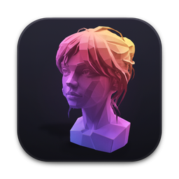
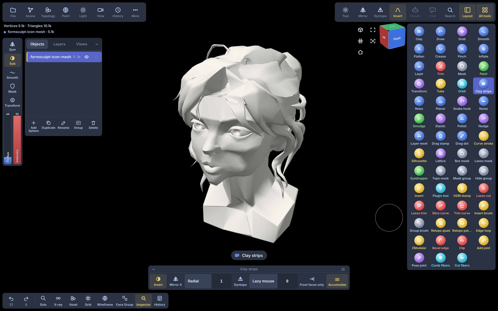
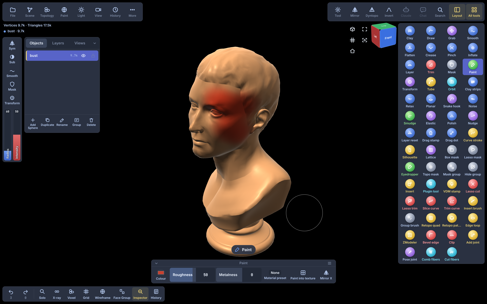

<p align="center">
  
</p>

<h1 align="center">FormSculpt</h1>

<p align="center">
  <b>3D sculpting; a Rust engine and a studio viewport for the Form family.</b><br>
  Brushes, quad remesh, UVs, painting and a path renderer,<br>
  on your own machine with no account. Agents sculpt over MCP.
</p>

<p align="center">
  
  
  
  
  
  
</p>

<p align="center">
  <a href="https://formsculpt.formai.studio/"><b>Download FormSculpt on formai.studio</b></a> ·
  <a href="#run-it-from-source">Run it from source</a> ·
  <a href="#the-form-family">All Form apps</a>
</p>

<p align="center">
  
  <br>
  <sub>The head bust the FormSculpt icon was made from, imported as FBX, shown with a white plaster matcap and worked over with Clay strips, Crease and Draw strokes.</sub>
</p>

<p align="center">
  <a href="#features">Features</a> ·
  <a href="#everything-in-the-box">In the box</a> ·
  <a href="#built-for-agents">Agents</a> ·
  <a href="#under-the-hood">Under the hood</a> ·
  <a href="#download">Download</a> ·
  <a href="#run-it-from-source">Run from source</a> ·
  <a href="#the-form-family">Form family</a>
</p>

<table>
  <tr>
    <td width="25%" valign="top">
      <h3>Rust engine</h3>
      One Cargo workspace does the sculpting, remeshing and baking, and compiles to WebAssembly so the window works with no service.
    </td>
    <td width="25%" valign="top">
      <h3>Full pipeline</h3>
      Sculpt, retopologize, unwrap UVs, paint, bake maps and path-render without leaving the window.
    </td>
    <td width="25%" valign="top">
      <h3>Local and private</h3>
      No account and no upload. The servers bind to 127.0.0.1 and your scenes stay on your machine.
    </td>
    <td width="25%" valign="top">
      <h3>Agent-ready</h3>
      The UI, the keyboard and an MCP server call the same 184 commands from one registry.
    </td>
  </tr>
</table>

## Features

<table>
  <tr>
    <td width="50%" valign="top">
      
      <br><sub>The same bust with the wireframe view on.</sub>
      <h3>Dense meshes, live</h3>
      Strokes run in a WebGL2 viewport, with dynamic topology, multires levels and voxel remesh underneath.
    </td>
    <td width="50%" valign="top">
      
      <br><sub>Vertex paint with colour, roughness and metalness.</sub>
      <h3>Paint on the model</h3>
      Paint layers, a Spotlight projection tool and texture painting sit beside the sculpt brushes.
    </td>
  </tr>
</table>

## Everything in the box

<table>
  <tr>
    <td width="33%" valign="top">
      <h4>Sculpt and topology</h4>
      Clay · Draw · Grab · Smooth · Crease · Snake hook · Dyntopo · Multires · Voxel remesh · Quad remesh · Decimate · Booleans
    </td>
    <td width="33%" valign="top">
      <h4>Surface and render</h4>
      UV unwrap · UDIM tiles · Map baking · Vertex paint · Paint layers · Spotlight · Path render · Lights and HDRIs
    </td>
    <td width="33%" valign="top">
      <h4>Formats</h4>
      Opens: <code>.fsc</code> · OBJ · STL · PLY · glTF/GLB · 3MF · FBX · USD · Saves: OBJ · STL · PLY · GLB · 3MF · Native: <code>.fsc</code>
    </td>
  </tr>
</table>

## Built for agents

184 commands live in one registry in `native/crates/fsc-commands`; the window, the keyboard and the MCP server all call them.

```sh
./formsculpt mcp                 # MCP server on stdio for Claude Code, Codex and Cursor
./formsculpt agents install      # register FormSculpt with Claude Code, Codex and Cursor
```

`.mcp.json`, `.codex/config.toml` and `.cursor/mcp.json` are already wired in this repo. See [`AGENTS.md`](AGENTS.md).

## Under the hood

- **Engine:** Rust crates for core, sculpt, topology, paint, I/O and the command registry (`native/`).
- **Window:** vanilla TypeScript and Vite with a WebGL2 viewport (`frontend/`), no UI framework.
- **Service:** a FastAPI engine service on 127.0.0.1:8260 (`backend/`), optional when the WebAssembly engine is built.
- **Tested:** engine suites, a service suite and a browser smoke test, run by `./formsculpt test`.

## Download

**Get the app:** download FormSculpt from [formai.studio](https://formsculpt.formai.studio/). **Keep it updated:** [FormPortal](https://github.com/nodemode-dev/formportal) installs, updates and rolls back every Form app from the same signed catalogue.

| Platform | Builds |
|---|---|
| macOS | Apple silicon |
| Windows | x64 |
| Linux | x64 |

All FormSculpt builds are compiled and released from [`nodemode-dev/formcompiler`](https://github.com/nodemode-dev/formcompiler/releases), not from this repo. This repo holds the source. No FormSculpt release has been published there yet.

## Run it from source

Prefer it in your browser, or want to contribute? Run the web UI straight from this repo.

**Requires:** Rust 1.99.1 (pinned in `rust-toolchain.toml`), Node 20.19+ or 22.12+, Python 3.12+.

```sh
git clone git@github.com:nodemode-dev/formsculpt.git
cd formsculpt
./formsculpt_oc_install     # checks the toolchain, installs the backend and frontend
./formsculpt                # backend on 8260, web UI at http://localhost:5260
```

To run with no service, build the browser engine with `./formsculpt engine wasm`, start `./formsculpt frontend`, and open `http://localhost:5260/?engine=wasm`. On Windows use `formsculpt_oc_install.bat` and `formsculpt.bat`. `./formsculpt desktop dev` opens the desktop window instead.

> [!IMPORTANT]
> **Status:** pre-release. CI builds the macOS and Windows bundles, but only the Linux build has been run. See [`CHANGELOG.md`](CHANGELOG.md).

**Contributing:** branch from `main`, keep changes to source here, and leave packaging and releases to formcompiler. See [`.docs/BRANCHING.md`](.docs/BRANCHING.md) and [`AGENTS.md`](AGENTS.md).

## Repository

| Path | What it is |
|---|---|
| `native/` | Rust engine workspace and the command registry |
| `frontend/` | Vite app: shell, engine client, WebGL2 viewport |
| `backend/` · `src-tauri/` | FastAPI engine service · Tauri 2 desktop shell |

Docs: [`.docs/wiki`](.docs/wiki) · Agents: [`CLAUDE.md`](CLAUDE.md), [`AGENTS.md`](AGENTS.md)

## The Form family

FormSculpt is one of the **Form apps**: native creative tools that install, update and roll back through FormPortal and can all be driven by agents.

| | App | What it's for | Download | Code |
|:-:|---|---|---|---|
|  | **form.md** | Documents, databases and realtime editing together | [formai.studio](https://formmd.formai.studio/) | [GitHub](https://github.com/nodemode-dev/form.md) |
|  | **FormAT** | Chat and agent workspace on your key | [formai.studio](https://format.formai.studio/) | [GitHub](https://github.com/nodemode-dev/format) |
|  | **FormCAD** | Drafting, parametric parts and NURBS surfaces | | [GitHub](https://github.com/nodemode-dev/formCAD) |
|  | **FormCel** | Spreadsheets agents can read and edit | [formai.studio](https://formcel.formai.studio/) | [GitHub](https://github.com/nodemode-dev/formcel) |
|  | **FormCraft** | Generate images, video, audio, 3D and worlds | | [GitHub](https://github.com/nodemode-dev/formcraft) |
|  | **FormCut** | Multi-track video editing with no upload | [formai.studio](https://formcut.formai.studio/) | [GitHub](https://github.com/nodemode-dev/formcut) |
|  | **FormDAM** | Photo library and asset manager | [formai.studio](https://formdam.formai.studio/) | [GitHub](https://github.com/nodemode-dev/formDAM) |
|  | **FormDeck** | Presentations and pitch decks | [formai.studio](https://formdeck.formai.studio/) | [GitHub](https://github.com/nodemode-dev/formdeck) |
|  | **FormDesign** | Page layout for print and the web | [formai.studio](https://formdesign.formai.studio/) | [GitHub](https://github.com/nodemode-dev/formdesign) |
|  | **FormEncoder** | Media encoding queue with presets | [formai.studio](https://formencoder.formai.studio/) | [GitHub](https://github.com/nodemode-dev/formencoder) |
|  | **FormFabric** | Sewing patterns draped with cloth simulation | | [GitHub](https://github.com/nodemode-dev/formfabric) |
|  | **FormLit** | Photo library and raw development | [formai.studio](https://formlit.formai.studio/) | [GitHub](https://github.com/nodemode-dev/formlit) |
|  | **FormMorpheus** | Frame-by-frame and performed animation | | [GitHub](https://github.com/nodemode-dev/formmorpheus) |
|  | **FormNET** | See what your computer sends online | | [GitHub](https://github.com/nodemode-dev/formNET) |
|  | **FormPath** | Vector illustration with artboards and type | [formai.studio](https://formpath.formai.studio/) | [GitHub](https://github.com/nodemode-dev/formpath) |
|  | **FormPDF** | Edit, redact, sign and fill PDFs | [formai.studio](https://formpdf.formai.studio/) | [GitHub](https://github.com/nodemode-dev/formpdf) |
|  | **FormPromo** | Promo films from your own media | [formai.studio](https://formpromo.formai.studio/) | [GitHub](https://github.com/nodemode-dev/formpromo) |
|  | **FormRef** | Reference boards for creative work | [formai.studio](https://formref.formai.studio/) | [GitHub](https://github.com/nodemode-dev/formref) |
|  | **FormRig** | Rig, skin and retarget any mesh | | [GitHub](https://github.com/nodemode-dev/formrig) |
|  | **FormSculpt** | 3D sculpting, remeshing and painting | [formai.studio](https://formsculpt.formai.studio/) | [GitHub](https://github.com/nodemode-dev/formsculpt) |
|  | **FormSurface** | Texture painting with PBR export | [formai.studio](https://formsurface.formai.studio/) | [GitHub](https://github.com/nodemode-dev/formsurface) |
|  | **FormTools** | Viewers, batch tools and file utilities | | [GitHub](https://github.com/nodemode-dev/formtools) |
|  | **FormTxt** | Word processing with .docx round trips | [formai.studio](https://formtxt.formai.studio/) | [GitHub](https://github.com/nodemode-dev/formtxt) |
|  | **FormVFX** | Motion graphics and VFX compositing | [formai.studio](https://formvfx.formai.studio/) | [GitHub](https://github.com/nodemode-dev/formvfx) |
|  | **FormVis** | Layered image editing with local AI | [formai.studio](https://formvis.formai.studio/) | [GitHub](https://github.com/nodemode-dev/formvis) |
|  | **FormWav** | Multitrack audio editing and mixing | [formai.studio](https://formwav.formai.studio/) | [GitHub](https://github.com/nodemode-dev/formwav) |
|  | **FormWeb** | Visual website building with a CMS | [formai.studio](https://formweb.formai.studio/) | [GitHub](https://github.com/nodemode-dev/formweb) |
|  | **FormPortal** | Install, update and roll back Form apps | [formai.studio](https://formportal.formai.studio/) | [GitHub](https://github.com/nodemode-dev/formportal) |
|  | **FormTray** | One dock icon for every app | [formai.studio](https://formtray.formai.studio/) | [GitHub](https://github.com/nodemode-dev/formtray) |
|  | **FormMCP** | One MCP connection to the family | [formai.studio](https://formmcp.formai.studio/) | [GitHub](https://github.com/nodemode-dev/formMCP) |
|  | **FormSkills** | Every app's agent skills in one place | [formai.studio](https://formskill.formai.studio/) | [GitHub](https://github.com/nodemode-dev/formskills) |
|  | **FormBench** | Parity, testing and rankings for the family | [formai.studio](https://formranker.formai.studio/) | [GitHub](https://github.com/nodemode-dev/formbench) |
|  | **FormSlot** | Codebase memory for coding agents | | [GitHub](https://github.com/nodemode-dev/formslot) |
|  | **SubForm** | Workbench for parallel Claude Code agents | | [GitHub](https://github.com/nodemode-dev/subform) |
|  | **FormCompiler** | Builds, signs and releases every app | [formai.studio](https://formcompiler.formai.studio/) | [GitHub](https://github.com/nodemode-dev/formcompiler) |
|  | **FormPipe** | Release pipeline and update feeds | | [GitHub](https://github.com/nodemode-dev/formpipe) |

## Maintainers

| Maintainer | Role |
|---|---|
| [@nodemode-ai](https://github.com/nodemode-ai) | Owner |
| [@gbarnai](https://github.com/gbarnai) | Co-owner |

Code owners are set in [`.github/CODEOWNERS`](.github/CODEOWNERS).

## License

FormSculpt is licensed under the Apache License 2.0 ([`LICENSE`](LICENSE), SPDX `Apache-2.0`). Copyright 2026 NodeAgentc, Inc. Third-party notices: [`NOTICE.md`](NOTICE.md).

<sub>Screenshot content: a CC0 model from Poly Haven. ZBrush is a trademark of Maxon Computer GmbH, and Nomad Sculpt is a trademark of its owner. FormSculpt is an independent project and is not affiliated with or endorsed by them.</sub>
